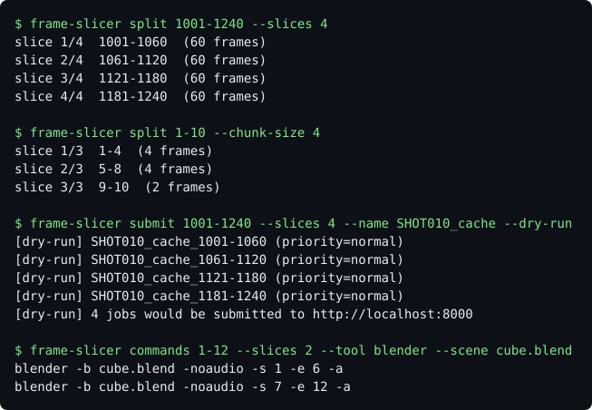
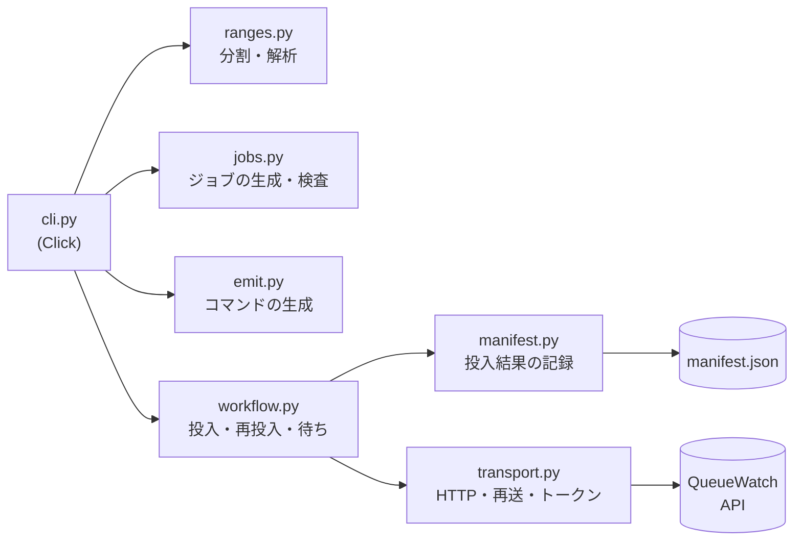

# FrameSlicer

フレーム範囲をスライスに分けて、1 スライスごとに 1 ジョブとして QueueWatch に投入する CLI ツールです。失敗したスライスだけの再投入、前段（キャッシュ）の完了待ち、レンダーコマンドの生成もできます。

> **English summary.** frame-slicer cuts a frame range into slices (by count or by size, with stepped and multiple ranges, heavy frames first) and submits one [QueueWatch](https://github.com/nokgc333/queuewatch) job per slice, each carrying its frame range and scene. A manifest records every submission, so `retry` can bring back only the failed slices under the same job id (no duplicates), and `submit --depends-on` holds a render stage back until the same frames of a cache stage succeeded. `commands` prints Blender, husk or hbatch command lines (it never runs them). The transport uses only the standard library: timeouts, a response size limit, retries only for failures that leave no job behind, a Bearer token that is sent over https or to localhost only, and no way to switch off TLS verification. Verified against a real QueueWatch worker running Blender 4.5.3; 254 tests at 100% coverage; CI on Ubuntu, macOS and Windows with Python 3.11 to 3.13.



## 目的・背景

キャッシュの書き出しのように、フレーム同士が独立した処理は、フレーム範囲を分けて並列に流せます。
FrameSlicer は、その分割（`split`）と、レンダーファーム QueueWatch への投入（`submit`）を、1 つのコマンドにまとめます。投入の結果は記録（マニフェスト）に残るので、失敗した分だけを `retry` で戻せます。

## 使えるもの、使えないもの

- **使える:** フレーム同士が独立した処理（キャッシュの書き出し、レンダーなど）。
- **使えない:** シミュレーション本体。シミュレーションは、前のフレームの結果に依存するため、フレームで分けると結果が変わります。
- 接続先の QueueWatch は、既定では疑似レンダーです。`RENDERER=blender` にすると、実際に Blender でレンダーします。ジョブは、名前・優先度・フレーム範囲（`frame_start` / `frame_end`）・シーンを持ちます。
- **実ワーカーで通した記録**: [docs/verification/real-render-blender-4.5.3.md](docs/verification/real-render-blender-4.5.3.md)（実 Blender で、分割 → 投入 → 失敗 → 再投入 → 後段まで）。

## 使用方法

範囲は `開始-終了`（両端を含む。Houdini の流儀）で指定します。

- `1-100x2`: 2 フレームおきに描きます（1, 3, 5 ... 99）。終わりは、実際に描く最後のフレームに揃います。
- `1-10,50-60`: 複数の範囲をカンマでつなげます（重なりは拒否）。複数の範囲は、`--chunk-size` で切ります。

### split: スライスを表示する

```bash
$ frame-slicer split 1001-1240 --slices 8
slice 1/8  1001-1030  (30 frames)
slice 2/8  1031-1060  (30 frames)
slice 3/8  1061-1090  (30 frames)
slice 4/8  1091-1120  (30 frames)
slice 5/8  1121-1150  (30 frames)
slice 6/8  1151-1180  (30 frames)
slice 7/8  1181-1210  (30 frames)
slice 8/8  1211-1240  (30 frames)
```

割り切れないときは、余りを前のスライスに 1 フレームずつ配ります（スライスの大きさの差は最大 1 です）。

切り方は 2 つあります（どちらか一方だけ）。

```bash
# 個数で切る（等分）
$ frame-slicer split 1-30 --slices 3

# 大きさで切る（最後だけ小さくなる）
$ frame-slicer split 1-10 --chunk-size 4
slice 1/3  1-4  (4 frames)
slice 2/3  5-8  (4 frames)
slice 3/3  9-10  (2 frames)

# 重いフレームを含むスライスを先頭に置く
$ frame-slicer split 1-30 --slices 3 --heavy 25-26
slice 1/3  21-30  (10 frames)
slice 2/3  1-10  (10 frames)
slice 3/3  11-20  (10 frames)
```

```bash
$ frame-slicer split 1001-1010 --slices 3
slice 1/3  1001-1004  (4 frames)
slice 2/3  1005-1007  (3 frames)
slice 3/3  1008-1010  (3 frames)
```

### submit: QueueWatch に投入する

```bash
# 送らずに、何を送るかを確認する
$ frame-slicer submit 1001-1240 --slices 8 --name SHOT010_cache --dry-run
[dry-run] SHOT010_cache_1001-1030 (priority=normal)
...
[dry-run] 8 jobs would be submitted to http://localhost:8000

# 実際に投入する
$ frame-slicer submit 1001-1240 --slices 8 --name SHOT010_cache
submitted SHOT010_cache_1001-1030 (id=1, status=pending)
submitted SHOT010_cache_1031-1060 (id=2, status=pending)
...
submitted SHOT010_cache_1211-1240 (id=8, status=pending)
8 of 8 jobs submitted
```

オプション:

- `--name`: ジョブ名の前半（必須）。スライスの範囲が、末尾に付きます。
- `--priority`: `high` / `normal` / `low`（既定は `normal`）。
- `--scene`: QueueWatch が描くシーン（`.blend`）。実レンダーでは必須です。
- `--manifest PATH`: 投入の結果を JSON に残します（スライスごとの id・状態・失敗の理由。1 つ送るたびに書き直します）。すでにあるファイルには書きません。
- `--depends-on PATH`: 前段のマニフェスト。同じフレームの前段のジョブが `success` になるまで、各ジョブを送らずに待ちます（前段が `dead` / `cancelled` になったら止まります。待ち時間の上限は `--wait-timeout`）。
- `--api-base-url`: QueueWatch の API のアドレス（既定は `http://localhost:8000`。環境変数 `QUEUEWATCH_API_URL` でも指定でき、オプションが優先されます）。
- `--dry-run`: 送らずに、内容だけを表示します。

QueueWatch が認証（トークン）を有効にしているときは、環境変数 `QUEUEWATCH_API_TOKEN` に editor 以上のトークンを入れます（`Authorization: Bearer` で送ります）。トークンはコマンドの引数に取らず、画面にもエラーにも出しません。

QueueWatch が受け付けるのは、連続した範囲だけです。`1-100x2` のような間引きは、`submit` では拒否します（`commands` を使います）。

QueueWatch に届かないときは、終了コード 1 で、投入できた件数を表示します。`--manifest` を付けていれば、続きは `retry` でできます。

```bash
$ frame-slicer submit 1001-1240 --slices 8 --name SHOT010_cache --api-base-url http://localhost:8999
Error: could not reach http://localhost:8999/jobs: [Errno 61] Connection refused
0 of 8 jobs submitted
```

引数の誤りは、終了コード 2 で知らせます。

```bash
$ frame-slicer split 1-3 --slices 5
Usage: frame-slicer split [OPTIONS] FRAMES
Try 'frame-slicer split --help' for help.

Error: more slices (5) than frames (3) in 1-3
```

### retry / status: 失敗した分だけを戻す

```bash
# 状態を見る（QueueWatch に今の状態を聞きます）
$ frame-slicer status cache.json
cube_1-3  id=1  success
cube_7-9  id=3  dead

# 送れなかったジョブを送り、dead / cancelled のジョブを requeue する（成功した分には触れない）
$ frame-slicer retry cache.json
kept cube_1-3 (id=1, status=success)
requeued cube_7-9 (id=3)
```

再投入は、新しいジョブを作らず、同じ id のジョブを QueueWatch の `requeue` で戻します。そのため、同じスライスが二重になりません。

### commands: レンダーコマンドを作る

```bash
$ frame-slicer commands 1-12 --slices 2 --tool blender --scene cube.blend
blender -b cube.blend -noaudio -s 1 -e 6 -a
blender -b cube.blend -noaudio -s 7 -e 12 -a

$ frame-slicer commands 1001-1010 --slices 1 --tool husk --scene scene.usd --output 'out.$F4.exr'
husk -f 1001 -n 10 -i 1 -o 'out.$F4.exr' scene.usd

$ frame-slicer commands 1-9x2 --slices 1 --tool hbatch --scene scene.hip --rop /out/mantra1
hbatch -c 'render -V -f 1 9 -i 2 /out/mantra1; quit' scene.hip
```

コマンドは表示するだけで、実行しません（シェルを通さない形で作り、引用符も付けます）。`--tool` は `blender` / `husk` / `hbatch`。Blender は `-j` で間引き、husk は `-n`（描くフレーム数）と `-i`、hbatch は `render -f 開始 終了 -i 刻み` を使います。フラグは各ツールの `--help` で確認したものです。

### 2 段のジョブ（キャッシュ → レンダー）

```bash
$ frame-slicer submit 1-120 --chunk-size 30 --name cache  --scene shot.blend --manifest cache.json
$ frame-slicer submit 1-120 --chunk-size 30 --name render --scene shot.blend \
      --depends-on cache.json --manifest render.json
```

後段は、同じフレームの前段が成功するまで送られません。

## 構成



- 計算（`ranges` / `jobs` / `emit`）は、外部に依存しない関数です。通信とファイルは、`transport` と `manifest` に閉じています。
- 仕様は [docs/spec.md](docs/spec.md)、設計判断は [docs/adr/](docs/adr/README.md)（5 本）に残しています。

## 技術スタック

- Python 3.11+
- [Click](https://click.palletsprojects.com/) 8.x（CLI フレームワーク。実行時の依存は、これだけです）
- HTTP は標準ライブラリの `urllib` を使います
- pytest / pytest-cov / mypy(strict) / black / isort / flake8 / pip-audit

## インストール

```bash
git clone https://github.com/nokgc333/frame-slicer.git
cd frame-slicer
python -m venv .venv && source .venv/bin/activate
pip install -e ".[dev]"
```

## テスト

```bash
pytest
black --check . && isort --check . && flake8 frame_slicer/ tests/ && mypy frame_slicer/
vulture frame_slicer/ vulture_whitelist.py
```

QueueWatch への投入は、ローカルの簡易サーバーに対する実際の通信で検査しています（応答の形、HTTP エラー、リダイレクト、遅い応答、巨大な応答、再送、トークン）。

実ワーカー（実 Blender）での通し検証は、`python scripts/verify_real_render.py`（手順は先頭のコメント、記録は `docs/verification/`）。CI には載せません。

## 設計メモ

- 範囲の解析と分割（`ranges.py`）は、純関数です。外部に依存せず、単体でテストできます。
- 責務ごとにファイルを分けています。
  - `jobs.py`: ジョブ名と優先度の検査、スライスからのジョブ生成（純関数）。
  - `transport.py`: HTTP での送信と、アドレスの検査（標準ライブラリの `urllib` だけ）。
  - `manifest.py`: 投入結果の記録（読み書きは、書き込みが完全に終わってから置き換える）。
  - `workflow.py`: 投入・再投入・前段の完了待ち。通信（`Api`）を差し替えられるので、テストでは実際の通信をしません。
  - `emit.py`: レンダーコマンドの生成（表示だけ）。
  - `errors.py`: 共通のエラー型。
- 安全のため、次の制限を設けています。
  - アドレスは `http` と `https` だけを受け付けます（`file:` などは拒否）。
  - リダイレクトは辿りません（送ったデータが、別の場所へ行かないようにするため）。
  - 通信のタイムアウトは 5 秒（接続と読み取りで共通）、応答の読み込みは 1MB までです（超えたら、その旨のエラー）。
  - 再送は、確実にジョブが作られていない失敗だけです（接続できない、HTTP 429、HTTP 503）。最大 4 回まで試し、待ち時間は指数的に伸ばして上限 8 秒、揺らぎ（ジッター）を付けます。`Retry-After` があれば従います（上限 30 秒）。読み取りのタイムアウトは再送しません（サーバーがすでにジョブを作っている可能性があり、二重投入になるため）。
  - 送るたびに `Idempotency-Key`（URL と内容から決まる値。再送でも同じ）を付けます。
  - トークンは `https`、または この PC 宛て（localhost）にだけ送ります。改行などの制御文字を含むトークンは拒否します。
  - 証明書の検証を無効にするオプションは、設けていません。
  - スライス数は、最大 1000 です。
  - ジョブ名は、QueueWatch の制限（1〜100 文字）に合わせ、制御文字を拒否します。

## 既知の制限事項

- `submit` で送れるのは、連続した範囲だけです（QueueWatch がフレームの間引きを持たないため）。間引きは `commands` で使えます。
- 途中で投入に失敗しても、すでに投入したジョブは取り消しません（件数を表示して終了します）。
- QueueWatch は `Idempotency-Key` をまだ解釈しません。`--manifest` を付けない `submit` を 2 回実行すると、ジョブが二重に作られます。`--manifest` を付ければ、すでにあるファイルには書かないので、2 回目は止まります（続きは `retry`）。1 回の通信の再送では増えません。
- `retry` は前段の完了を待ちません（待つのは `submit --depends-on` の間だけ）。
- 実ワーカーでの検証は、Blender 4.5.3 だけです。`hbatch` / `husk` のコマンドは、フラグを各ツールの `--help` で確認しましたが、実際には実行していません。
- 動作は、CI で Ubuntu・macOS・Windows の 3 OS × Python 3.11〜3.13 で確認しています（実ワーカーでの検証は macOS のみ）。`commands` が出す引用符は、POSIX シェルの形です。

## ライセンス

MIT
